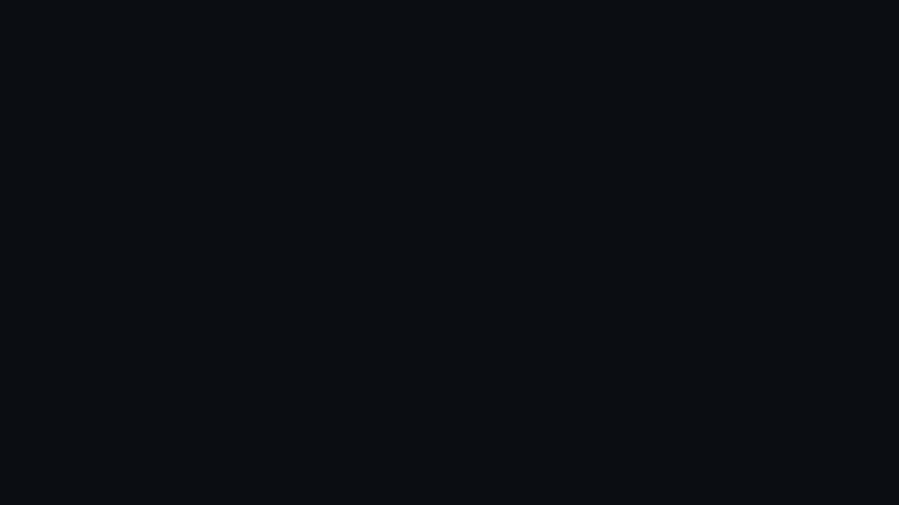
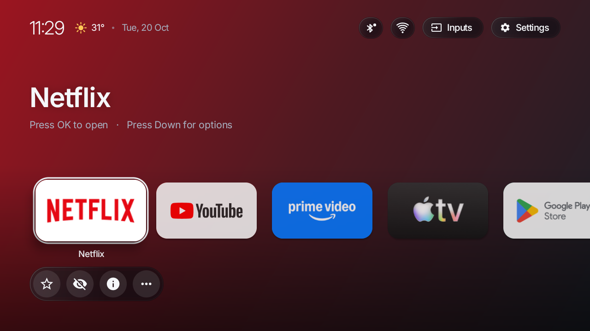
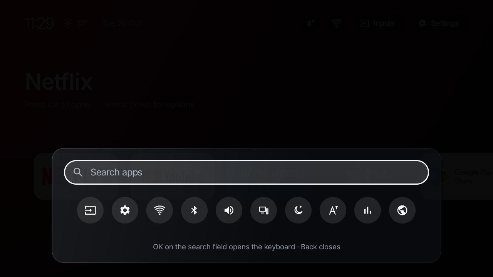
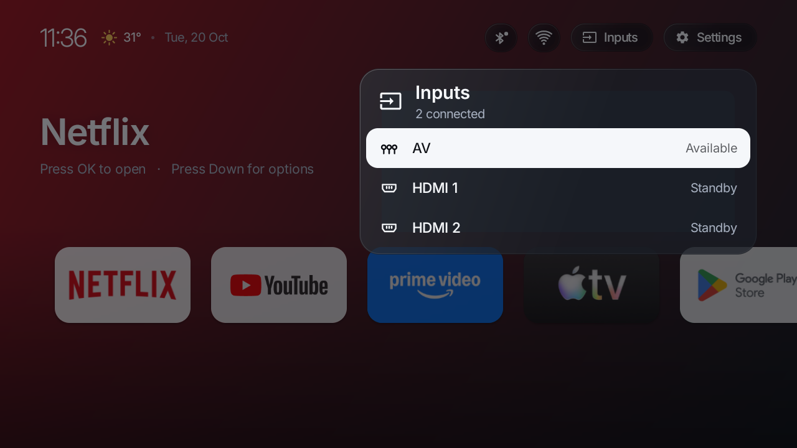
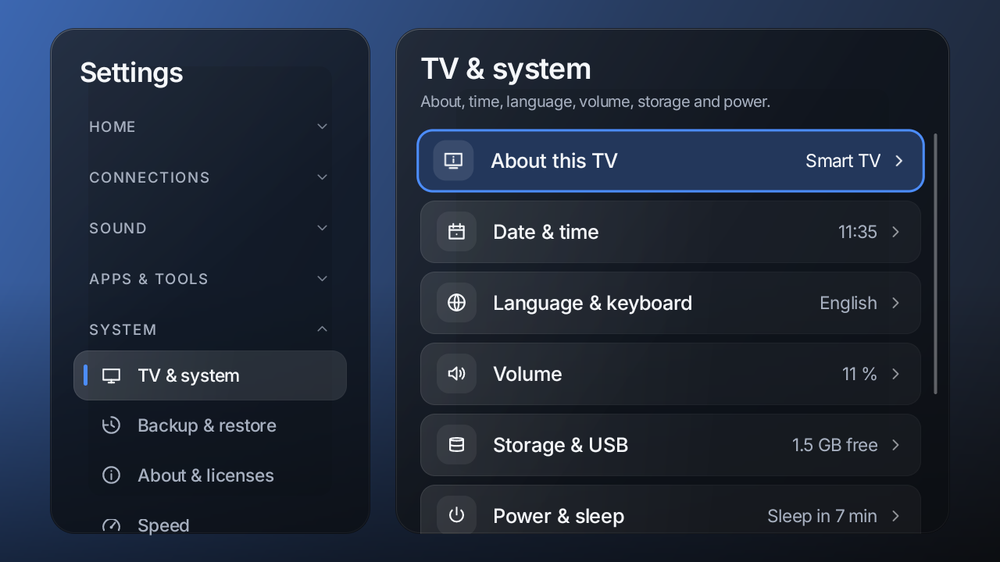
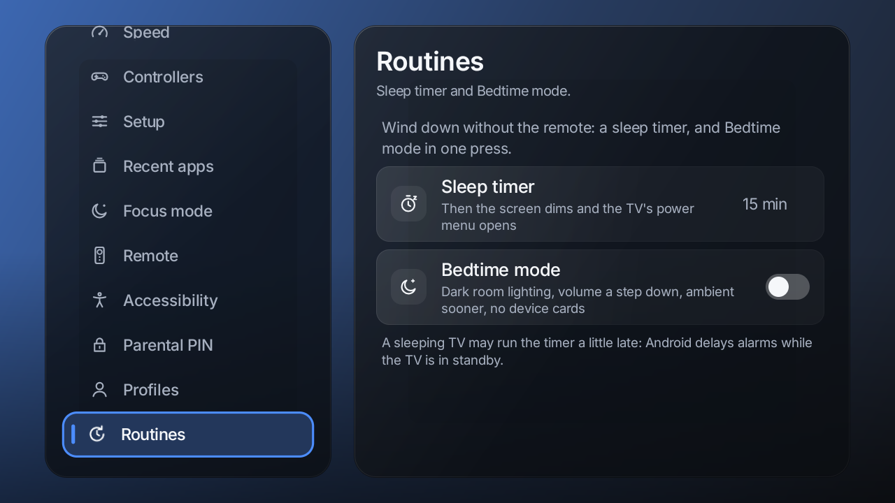

# Horizon

A fast, minimal, glassy home screen for Android TV. Built and tested on a 1 GB TCL TV, so it stays smooth on weak
hardware and looks better on strong hardware.

On screen it is called **H02**. Horizon is the project name.

| | | |
|---|---|---|
|  |  |  |
|  |  |  |

## What it does

- **Home:** one row of apps with each app's brand colour as the backdrop, a clock, weather and quick controls. Five
  layouts: single row, two rows, grid, big hero and minimal.
- **Glass:** frosted, clear, solid and a liquid-glass-inspired style, with text kept readable on any wallpaper.
- **Spotlight:** search apps, settings, recent items and the web, plus quick actions you can reorder.
- **Continue watching:** hover an app to see what you were watching (needs the TV's Watch Next list).
- **Now playing:** the cover art becomes the backdrop and a mini player stays on Home.
- **Screensaver:** real time and weather, original wallpapers and your own picture folders.
- **Settings that replace the TV's:** Wi-Fi, Bluetooth, devices, inputs, sound, accessibility, controllers, profiles,
  speed, private DNS, routines, sleep timer and focus mode.
- **First-run setup** that configures a new TV and restores a saved setup from a USB stick.
- **Game controllers** and remote work everywhere.
- **Room lighting** that follows sunrise and sunset from the weather.
- **Companion apps:** Browser (with a pointer for the D-pad), Store, Weather, Helper and Link (phone as remote).

The launcher itself has **no internet permission**. Anything that needs the network lives in a companion app.

## Install

Download the APKs from the [latest release](../../releases/latest) and install them on the TV:

```
adb connect <tv-ip>:5555
adb install -r H02-h02-1.0.0.apk
```

For a full setup (permissions, taking over Home, undo script) use the provisioning tool, which prints every step before
it runs and writes an undo script:

```
cd tools
python3 -m tvtool provision --host <tv-ip> --apks <folder-with-apks> --apply
```

See [docs/PROVISIONING.md](docs/PROVISIONING.md). Making Horizon the default home on TVs that hard-wire their own
launcher (TCL does) needs `--take-over-home`, which disables the stock launcher. It can be undone with one command.

## Honest limits

These come from the TV's firmware, not from Horizon:

- The firmware keeps the volume keys and its volume pop-up, so apps cannot replace them.
- Some TVs stop background accessibility services. The Helper's extras (double-Back, controller Guide button from other
  apps) may pause on those TVs. Everything inside Horizon is unaffected.
- Picture and sound processing menus, system updates and factory reset belong to the TV and stay there.
- Apps only see what other apps publish. Continue watching and the cover-art backdrop depend on that.
- The phone remote works fully on Home and in Settings. Other apps need the Helper.

Details are in [docs/SYSTEM_SETTINGS.md](docs/SYSTEM_SETTINGS.md) and [docs/OS_PARITY.md](docs/OS_PARITY.md).

## Build

JDK 17 or newer (the one bundled with Android Studio works) and the Android SDK.

```
cd launcher
./gradlew testDebugUnitTest assembleDebug
```

Signed release builds need your own keystore. Unit tests cover the logic of every module. Layout checks run on a real
TV with `tools/audit`.

## Brand

- **Product name:** Horizon. **On-screen mark:** `H02`. The companions are H02 Browser, Store, Weather, Helper and Link.
- **Fonts:** Inter for text and Unbounded for the mark, both under the SIL Open Font License. Sources and hashes are in
  [launcher/fonts/FONTS.md](launcher/fonts/FONTS.md).
- Package names (`dev.tvlauncher.*`) are internal ids.

## Not affiliated

Horizon is an independent project. It is not made by, endorsed by or connected to TCL, Google, Apple, Netflix, Spotify
or any other company or service named in the code or screenshots. All names and logos belong to their owners. The
name "Horizon" is also used by other products; check it before using it commercially.

## License

[MIT](LICENSE). Third-party notices are in the app (Settings, About & licenses) and in
`launcher/app/src/main/res/raw/`.
